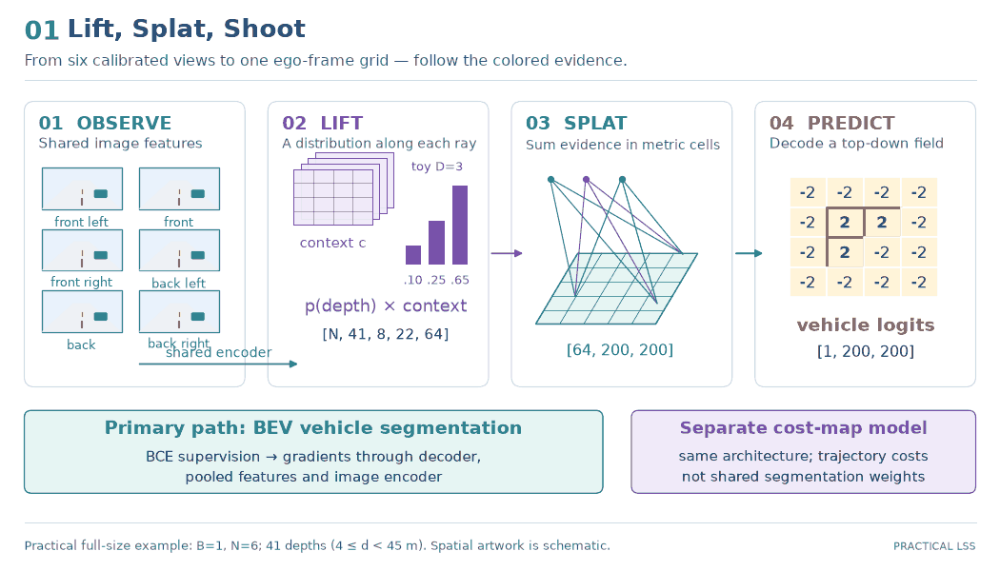
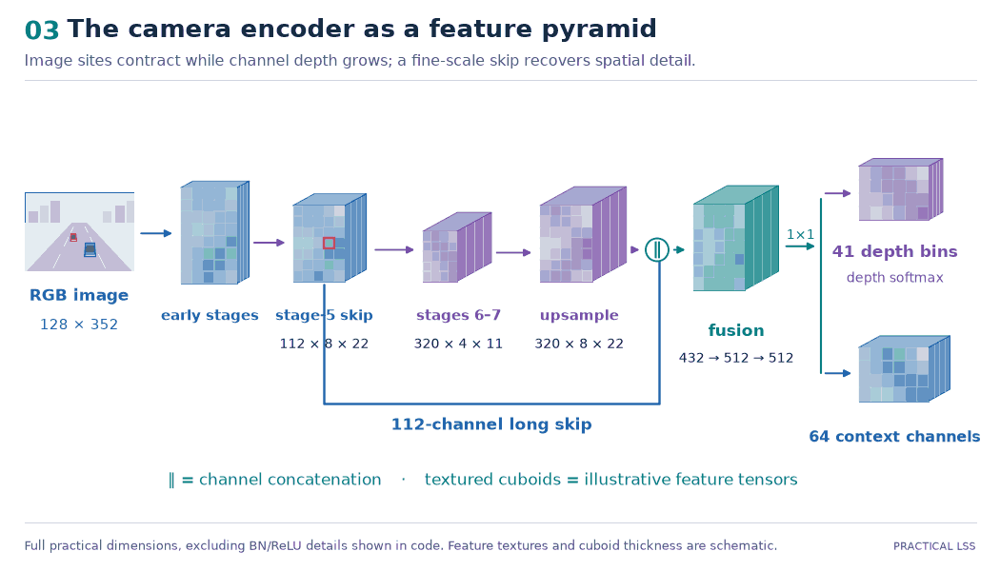
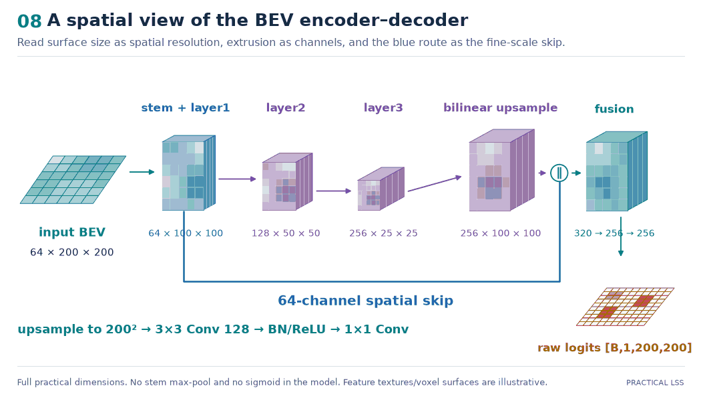

# Lift, Splat, Shoot — From Scratch

[](https://github.com/bskkimm/Lift-Splat-Shoot-from-Scratch/actions/workflows/tests.yml)

**An inspectable PyTorch implementation of multi-camera bird's-eye-view perception,
with an illustrated, standalone architecture walkthrough.**

[Paper](https://arxiv.org/abs/2008.05711) ·
[Walkthrough notebook](notebooks/lss_e2e_walkthrough.ipynb) ·
[Command guide](COMMAND_GUIDE.md) ·
[Paper-to-code audit](docs/paper-to-code.md)



*Observe the scene, lift image features along calibrated rays, and sum the evidence
into a common top-down grid. The artwork is schematic; shape labels describe the
practical implementation.*

The core task is **BEV vehicle segmentation**: predicting occupied cells around
the ego vehicle from its cameras. An experimental **trajectory-scoring** model
also illustrates the paper's “shoot” operation. Model components are implemented
locally with PyTorch and TorchVision primitives; the nuScenes SDK supports dataset
conventions and split selection.

> **Research status:** the practical segmentation path, teaching notebook and
> verification tools are implemented. Faithful reference-model reproduction,
> original-checkpoint compatibility and paper-result parity remain unverified.
> See [implementation status](#implementation-status) for the evidence and gaps.

## Start with the notebook

The [end-to-end walkthrough](notebooks/lss_e2e_walkthrough.ipynb) defines the model
in ordered cells and follows each component through **intuition → equations →
tensor shapes → implementation → executable probe**.

- **14 embedded illustrations:** camera rigs and street views, feature pyramids,
  depth frusta, voxel accumulation, the BEV decoder, losses and trajectory costs.
- **A real synthetic optimizer step:** forward pass, BCE objective, gradients,
  Adam update, inference and diagnostic IoU.
- **Offline CPU execution by default:** seeded synthetic inputs, random weights
  and no dataset or network access required at runtime.
- **Explicit opt-ins:** real nuScenes samples, practical checkpoints, package
  parity and practical validation evaluation, with errors for missing assets.

Figures remain visible when the notebook is copied alone. Editable SVGs, source
references and regeneration commands are in the
[architecture asset guide](notebooks/assets/architecture/README.md).

| Camera feature pyramid | BEV encoder–decoder |
| --- | --- |
|  |  |

## How the model works

1. **Encode and lift.** A shared EfficientNet-B0 image encoder predicts a
   categorical depth distribution and context features. Their outer product
   distributes each image site's evidence across depth bins.
2. **Unproject.** Undo image augmentation, apply camera intrinsics, and transform
   pixel/depth samples into the reference ego frame.
3. **Splat.** Reject out-of-range points and sum lifted features into metric voxel
   cells, preserving feature channels and height-bin ordering.
4. **Decode.** A ResNet-block BEV encoder–decoder predicts raw vehicle-occupancy
   logits. Training uses BCE; validation aggregates intersection and union counts.
5. **Shoot — experimental.** A separate cost-map model scores trajectory templates
   by negative accumulated cost, then normalizes scores across candidates.

### Practical full-size defaults

| Quantity | Default |
| --- | --- |
| Image size | 128 × 352 pixels |
| Validation cameras | Six named nuScenes cameras |
| Latent depth | 41 bins: 4, 5, …, 44 m; upper endpoint 45 m excluded |
| Context features | 64 channels |
| BEV grid | 200 × 200 cells; x/y in [−50, 50) m at 0.5 m resolution |
| Output | Vehicle logits `[B,1,200,200]` |

These are current package defaults, not a claim of a verified faithful recipe.
The notebook's small CPU probes use explicitly reduced dimensions.

## Quick start

Use an activated Python environment from the repository root. Python **3.10 and
3.11** are the current CI targets. Install compatible PyTorch/TorchVision builds
for your system; see the [PyTorch installation selector](https://pytorch.org/get-started/locally/).
Then install the package and test dependency:

```bash
python -m pip install -e . pytest
```

Run the standalone lesson without a dataset:

```bash
MPLBACKEND=Agg python scripts/execute_notebook.py notebooks/lss_e2e_walkthrough.ipynb
```

Inspect full-size model construction without performing optimization:

```bash
python train.py --dry-run --seed 0
```

The notebook can also be opened in Jupyter or VS Code. Its architecture images
are already embedded; no generation step is needed to view them. Dataset files,
pretrained weights and trained checkpoints are external assets. Dependencies
are declared, but a fully locked reproducible environment is still
part of the ongoing rebuild.

## Train and evaluate with nuScenes assets

Provide the metadata and camera images under your nuScenes root, with
`v1.0-mini/` or `v1.0-trainval/` containing the metadata tables and image paths
matching their recorded filenames. Named train/validation scene splits are
selected through the nuScenes devkit.

Example **asset-dependent** mini-dataset training and subset evaluation:

```bash
python train.py --dataroot /path/to/nuscenes --version v1.0-mini \
  --epochs 1 --batch-size 1 --device cpu --output-dir outputs/practical-mini

python eval.py --checkpoint outputs/practical-mini/last_checkpoint.pt \
  --max-samples 8 --output outputs/practical-mini/validation-subset.json
```

The default `practical` recipe uses FP32, direct resize, random image-encoder
initialization and zero loader workers. `--recipe reference-data` adds
reference-oriented image augmentation and five-camera training subsets; it
retains documented architecture/geometry differences and is not a faithful
reproduction recipe.

Checkpoints record configuration and support epoch-boundary resume. Evaluation
recovers its recipe from the checkpoint and labels the metric
`practical_bev_vehicle_iou`; `--max-samples` explicitly marks a subset diagnostic.
See the [command guide](COMMAND_GUIDE.md) for resume, local checksum-verified
backbone initialization, full-split evaluation and CUDA options.

## Implementation status

| Area | Available evidence | Remaining work |
| --- | --- | --- |
| Camera encoder, geometry, lift/splat and BEV decoder | Analytical/synthetic probes; notebook/package matched-weight outputs, gradients and training-step state | Original-reference numerical and checkpoint parity |
| nuScenes data and vehicle masks | Official split filtering; synthetic fixtures; validation split count and one real sample's independently checked mask and camera transforms | Full-dataset coverage, multiworker reproducibility and end-to-end resource sizing |
| Segmentation train/eval and recovery | Practical CLI; synthetic optimization, validation and CPU epoch-boundary resume checks | Full real-data training, GPU resume/precision validation and paper results |
| Teaching notebook and figures | Fresh-process offline execution; architecture inventory/parity; image integrity, numerical examples and deterministic rendering checks | Faithful-recipe and full-resolution reference coverage |
| Trajectory planning | Separate cost-map/template-scoring primitives and synthetic output/gradient checks | Planning data preparation, training protocol and real-data metrics |

The [real-data report](docs/analysis/real-nuscenes-loader-smoke.md) records the
single-sample checks and their resource use. Those checks do not establish model
performance or parity across nuScenes.

No paper IoU or planning benchmark result is claimed. Differences in backbone
initialization, camera-to-ego conventions, data ordering and training settings
are tracked in the [paper-to-code audit](docs/paper-to-code.md). The historical
`OfficialConfig` name is not evidence of a validated paper configuration.

## Verification and development

```bash
python -m pytest -q
python scripts/illustrate_notebook.py --check
```

The default tests use synthetic inputs. Real-data and CUDA checks are explicit
opt-ins; their prerequisites and scope are documented in the command guide.

[Current CI](.github/workflows/tests.yml) runs the Python 3.10/3.11 test matrix,
including notebook execution/parity and illustration checks, plus Ruff F, a
narrow strict mypy target and pre-commit hygiene. The aggregate `current CI gate`
checks those jobs. Broader lint/format, typing, packaging, dependency audit and
documentation/configuration gates remain incomplete. Automated-review freshness
is a procedural requirement, not a required CI status.

### Find the implementation

```text
notebooks/lss_e2e_walkthrough.ipynb   Standalone architecture and worked lesson
notebooks/assets/architecture/      PNG/SVG figures, inventory and provenance
lss/models/                        Camera encoder, voxel pool, segmentation, planner
lss/geometry.py                    Frustum construction and coordinate transforms
lss/data/                          nuScenes indexing, augmentation and BEV targets
lss/segmentation_engine.py          Segmentation optimization and validation
lss/training_checkpoint.py          Epoch-boundary state and RNG recovery
train.py / eval.py                 Practical command-line workflows
```

## Paper and reference

This project studies [Lift, Splat, Shoot: Encoding Images from Arbitrary Camera
Rigs by Implicitly Unprojecting to 3D](https://arxiv.org/abs/2008.05711), by Jonah
Philion and Sanja Fidler, ECCV 2020. The
[reference implementation](https://github.com/nv-tlabs/lift-splat-shoot/tree/2903467c91ee9c12f0917a12c22ab1f04e607ae0)
is pinned in the audit for source comparison.

```bibtex
@inproceedings{philion2020lift,
  title={Lift, Splat, Shoot: Encoding Images from Arbitrary Camera Rigs by Implicitly Unprojecting to 3D},
  author={Philion, Jonah and Fidler, Sanja},
  booktitle={European Conference on Computer Vision},
  year={2020}
}
```
